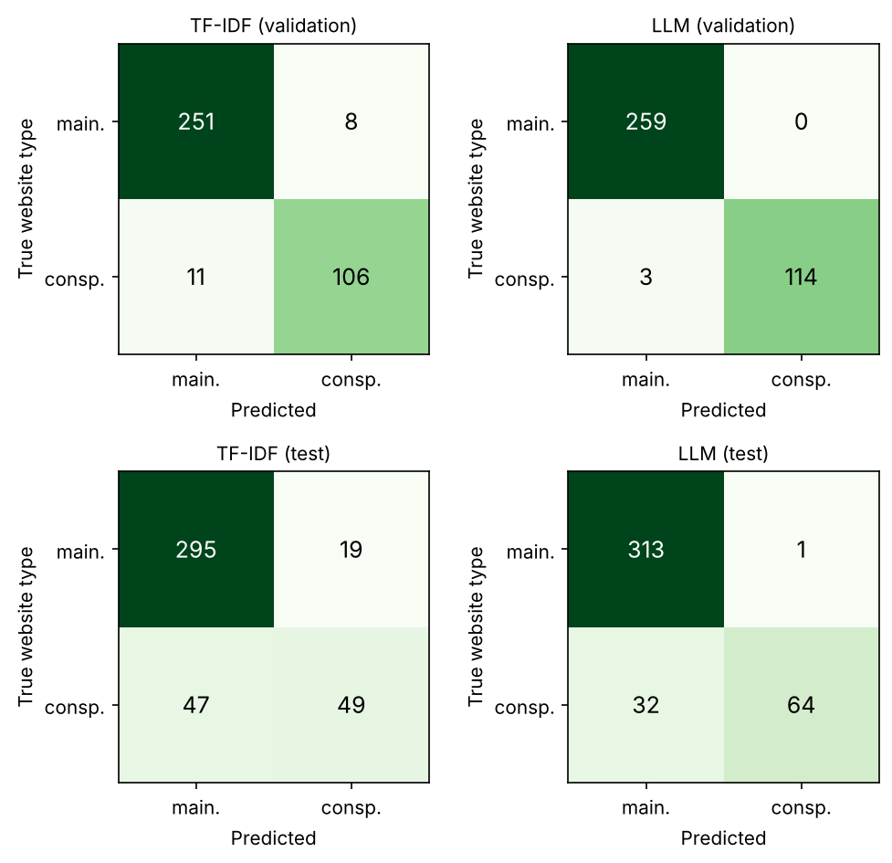

# Conspiracy or mainstream? Classifying 9/11 articles with logistic regression and an LLM

## Question and hypotheses

### Executive summary

We asked whether the text of a full 9/11 article reveals if it comes from a conspiracy-oriented or a mainstream website, comparing three logistic regressions and one low-cost language model, Claude Haiku 5.5, on 410 held-out test articles. The language model reached the highest conspiracy-class F1, 0.795, against 0.598 for the best logistic regression (TF-IDF). With supported meaning a difference in the predicted direction and McNemar's p < 0.05, H1 (weighting words helps) was supported, narrowly, H2 (hand-made features help) was not supported, and H3 (the language model beats the best logistic regression) was supported. All models missed at least three in ten conspiracy articles, and the test rests on six conspiracy websites.

### Introduction

The attacks of 11 September 2001 are among the most persistent subjects of conspiracy theories: claims that they were an "inside job", a "controlled demolition" or a "false flag" are actively argued for online (Wood & Douglas, 2013) and have been studied as a widely held belief (Swami, Chamorro-Premuzic & Furnham, 2010). In a 2006 survey, 36 percent of Americans found it credible that federal officials helped the attacks happen or deliberately failed to stop them (Stempel, Hargrove & Stempel, 2007). Automatic detection of misleading web content is an active research field (Shu et al., 2017). This study asks whether the text of a full 9/11 article reveals if it was published on a conspiracy-oriented or a mainstream website, using machine-learning methods for text classification.

We compare four methods that form a ladder from simple to rich: logistic regression on word counts, the plainest baseline; logistic regression on TF-IDF weights, the standard step beyond counting (Salton & Buckley, 1988; Manning, Raghavan & Schütze, 2008); logistic regression on TF-IDF plus three groups of hand-made features (word sequences, certainty words, style); and a low-cost LLM used without training (zero-shot). Logistic regression is simple, well understood and its weights can be read as word lists (Hastie, Tibshirani & Friedman, 2009). As a basic check, every trained model should beat always guessing "mainstream". Beyond that we test three hypotheses:

- **H1.** TF-IDF reaches a higher conspiracy-class F1 than word counts, because distinctive words carry more information than common ones.
- **H2.** TF-IDF plus the three feature groups reaches a higher F1 than TF-IDF alone, because these features capture how conspiracy texts argue.
- **H3.** The LLM reaches a higher F1 than the best logistic regression, because it brings broad knowledge of how texts are written.

What we did not do, and why:

- *Other classifiers*: the question is about the input, so the classifier stays fixed.
- *Fine-tuning a language model*: it needs more labelled data and money than a small study has.
- *Emotion features*: fear and anger are normal in any report on an attack.
- *Full texts or other language models*: all methods read the same first 3,000 words, and the course asked for one inexpensive model.

The pipeline, without the language model, runs on an ordinary computer (the last run: two processor cores, Python 3.11) in about two minutes, about one of which is the feature model; only the language model needs an internet connection and a paid service.

All methods are judged by precision, recall and F1 for the conspiracy class, because most articles are mainstream and accuracy would reward a model that never finds a conspiracy article. Two models are compared with McNemar's test on the articles where exactly one of them is right, the recommended test for two classifiers on the same test set (Dietterich, 1998); separate confidence intervals describe uncertainty but do not decide. A hypothesis is supported if the difference points in the predicted direction and McNemar's test gives p < 0.05, and not supported otherwise.

The four methods at a glance:

| Method | Input | Reads | Trained on our data | Settings | Runtime | Cost |
|---|---|---|---|---|---|---|
| 1. Word counts + logistic regression | word counts | first 3,000 words of each article | yes | C from [0.01, 0.1, 1, 10, 100], class weight balanced, chosen on validation | a few seconds | free (runs locally) |
| 2. TF-IDF + logistic regression | TF-IDF weights | first 3,000 words of each article | yes | C from [0.01, 0.1, 1, 10, 100], class weight balanced, chosen on validation | a few seconds | free (runs locally) |
| 3. TF-IDF + features + logistic regression | TF-IDF weights, n-grams, certainty words, style | first 3,000 words of each article | yes | C from [0.01, 0.1, 1, 10, 100], class weight balanced, chosen on validation | about a minute | free (runs locally) |
| 4. LLM (claude-haiku-5-5) | the article text itself, with a written question | first 3,000 words of each article | no | prompt v1 of 3, default sampling | about 1.0 seconds per article | about $0.26 per 1,000 articles |

*The four methods at a glance*

## Data and cleaning

The study uses the 9/11 subset of the LOCO corpus (Miani, Hills & Bangerter, 2022), a collection of web pages from websites rated as conspiracy-oriented or mainstream. In their own blind check of 60 documents per subcorpus, 85% of the conspiracy and 92% of the mainstream documents were correctly labelled. We use the full articles of this subset, 3,146 documents from 39 conspiracy and 79 mainstream websites. Each document carries the label of its website, so the label describes the publisher and not the single text. The texts belong to their publishers, and no licence terms for the corpus could be confirmed, so the texts are kept in a private data store and this report shows only counts and short excerpts. The work used Python 3.11.17 with pandas, scikit-learn 1.9.1 (Pedregosa et al., 2011) and the Anthropic client library.

A classifier takes the easiest signal that separates the classes; this shortcut learning (Geirhos et al., 2020), a form of target leakage (Kaufman et al., 2012), arises when site names, boilerplate, topics or copies reveal the label. All cleaning was therefore applied before any model was fitted. First, documents that do not mention the attacks in their title or text were removed (3,146 to 2,608), because a model could otherwise learn topics instead of kinds of websites. Second, near-duplicates were removed (2,608 to 2,554), so that no model meets a near copy of a test article during training: pairs with a cosine similarity of their TF-IDF vectors of at least 0.9 (a lower threshold would also remove different articles on the same event). The copy in the earlier set (training, then validation, then test) is kept. Third, web addresses, e-mail addresses, website names and lines repeated across many documents of one website were deleted from the texts. This step edited 2,498 texts but removed no document.

| Step | Removed | Remaining | Conspiracy removed | Mainstream removed | Conspiracy remaining | Mainstream remaining |
|---|---|---|---|---|---|---|
| all documents | 0 | 3146 | 0 | 0 | 939 | 2207 |
| off-topic articles removed | 538 | 2608 | 162 | 376 | 777 | 1831 |
| near-duplicates removed | 54 | 2554 | 22 | 32 | 755 | 1799 |

*Documents before and after each cleaning step*

After cleaning, 2,554 documents from 37 conspiracy and 79 mainstream websites remain: 755 conspiracy and 1,799 mainstream, so the classes are unbalanced. The shortest document has 101 words, so every document is a real article and no minimum length was needed.

## Splitting by website

The documents were divided into a training set, a validation set and a test set with target shares of 70%, 15% and 15%. The division was made by website, so that no website appears in more than one set and no model is rewarded for recognising a website it has seen. The division was stratified by label: conspiracy and mainstream websites were assigned separately, from the largest to the smallest website, to the set that was furthest short of its target share, with a fixed random seed for ties. The assignment was made once and never changed.

| Set | Class | Websites | Documents | Share of documents |
|---|---|---|---|---|
| train | conspiracy | 25 | 542 | 0.212 |
| train | mainstream | 54 | 1226 | 0.48 |
| validation | conspiracy | 6 | 117 | 0.046 |
| validation | mainstream | 13 | 259 | 0.101 |
| test | conspiracy | 6 | 96 | 0.038 |
| test | mainstream | 12 | 314 | 0.123 |

*Websites and documents per set and class*

Because websites cannot be divided, the shares only approximate the targets. After cleaning, the training, validation and test sets contain 25, 6 and 6 conspiracy websites and 54, 13 and 12 mainstream websites.

## Word counts

The first analysis represents each article as a bag of words: a vector with the number of times each word occurs, ignoring order. Words were counted on the training articles only, and words occurring in fewer than two training articles were dropped. Logistic regression (Hastie, Tibshirani and Friedman, 2009) gives each word a weight, adds the weights of the words in an article and turns the sum into a probability that the article comes from a conspiracy website. Class weights were balanced because conspiracy articles are the smaller group, and each article was cut to its first 3,000 words, as for all methods; the full texts would have given the logistic regressions information the language model never sees. The regularisation strength C, which pulls the weights towards zero (Hastie, Tibshirani and Friedman, 2009, ch. 4), was chosen from {0.01, 0.1, 1, 10, 100} by the validation F1 score of the conspiracy class. All numbers here are validation numbers; as expected, the model clearly beats always guessing mainstream, whose F1 is zero.

The smallest value, C = 0.01, scored best, with a precision of 0.828, a recall of 0.906 and an F1 score of 0.865. Larger values scored lower (F1 0.797 at C = 100), the typical sign of overfitting: with raw counts the model starts to rely on rare words that only describe the training articles. The best value lies at the lower edge of the grid; the grid was fixed before the run and was not widened afterwards, so an even more cautious model might score slightly higher. Of the 117 conspiracy articles in validation the model found 106, and of the 259 mainstream articles it called 22 conspiracy.

The words with the largest weights are informative, but not all are about content. Words such as "posted", "am" and "article" among the strongest conspiracy words look like habits of how a website presents its articles. Mainstream words such as "killed", "says" and "anniversary" fit factual news reporting. The model therefore partly recognises websites and not only arguments.

## TF-IDF

The second analysis keeps everything from the word-count analysis (articles, split, vocabulary, balanced class weights and the choice of C by validation F1) and replaces raw counts by TF-IDF weights (Salton and Buckley, 1988; Manning, Raghavan and Schütze, 2008). Term frequencies were damped with a logarithm, article vectors were scaled to unit length, and the inverse document frequencies were computed on the training articles only. All numbers here are validation numbers; on validation TF-IDF scores higher than word counts, as H1 expects, but only the test decides.

The value C = 10 scored best, with a precision of 0.930, a recall of 0.906 and an F1 score of 0.918. Larger C helped here: because TF-IDF vectors have a fixed length, the model can use larger weights without being dominated by long articles. The chosen value lies inside the grid, and C = 100 scored almost the same (F1 0.909).

The strongest words resemble those of the word-count model. "Posted", "truth" and "article" point to conspiracy websites; "killed", "tower" and "york" point to mainstream websites. Part of this signal reflects how websites present their articles.

## TF-IDF plus extra features

The third analysis tests H2 by adding three groups of hand-made features to TF-IDF. N-grams of one to three words capture phrases such as "inside job"; word and bigram features are a strong baseline for text classification (Wang and Manning, 2012). Epistemic markers are counts per 1,000 words of four short hand-made lists: hedges (doubt words such as "perhaps"), boosters (certainty words such as "clearly"), hidden-truth phrases and debunking words, following work that ties conspiracy discourse to certainty and concealment (Marini and Jezek, 2024; Islam et al., 2020; but see Fong et al., 2021). Style features are capitals, punctuation, quotation marks, sentence length and repetition, the last measured as the share of different words in windows of 100 words (MATTR) (Horne and Adali, 2017); this evidence comes from fake-news data, not conspiracy websites, and such features generalise poorly across domains (Pérez-Rosas et al., 2018).

The numeric groups were standardised with training statistics only. In an ablation, which switches one ingredient on or off, six logistic regressions with the same settings were compared on validation: TF-IDF alone, with each group, with all three (the planned final model), and with certainty words and style but without n-grams. 

| Model | Validation F1 | Change against TF-IDF alone |
|---|---|---|
| TF-IDF alone | 0.918 | reference |
| + n-grams (1-3) | 0.920 | +0.002 |
| + certainty words | 0.930 | +0.013 |
| + style | 0.909 | -0.009 |
| + all three groups | 0.896 | -0.022 |
| + certainty words and style (no n-grams) | 0.913 | -0.005 |

Style lowers validation F1 on its own (0.909). Certainty words and style without n-grams reach 0.913, but all three groups only 0.896: the n-grams add 146,172 columns for 1,768 training articles, which probably makes it easy to fit single articles, and style habits such as capitals may describe single websites rather than conspiracy writing. These are likely explanations that fit the table, not tested causes: with 376 validation articles, one hundredth of F1 is about one or two of the 117 conspiracy articles, so no single group differs from TF-IDF alone by more than chance would allow, and the full combination chose the largest regularisation value in the grid (each row chooses its own value on validation). Certainty words are the only group that helps alone (0.930). The planned model is the full combination, so its result decides H2.

## The LLM classifier

The fourth analysis uses a language model instead of a trained classifier. Claude Haiku 5.5 is the lowest-cost model of Anthropic's Claude 5.5 family, chosen because the course asked for one inexpensive model rather than a comparison of language models; it was called through Anthropic's API in October 2026, one request per article, and had to answer in a fixed short format (label, confidence, one-line reason) of at most 1,000 tokens. The cost, about $0.26 per 1,000 articles, follows from the counted tokens at the list price ($0.10 and $0.50 per million input and output tokens). It received each article without examples (zero-shot) and answered whether it would appear on a conspiracy-oriented or a mainstream website; the answers are scored against the same labels.

Articles were cut to their first 3,000 words, as for the other methods; the model has no temperature setting, so default sampling was used. Three prompts were tried on validation only: the bare question (v1), the question with short definitions of both website types (v2), and a step-by-step version that warns against judging by topic (v3).

| variant | documents | precision | recall | f1 |
|---|---|---|---|---|
| v1 | 376 | 1.0 | 0.974 | 0.987 |
| v2 | 376 | 1.0 | 0.966 | 0.983 |
| v3 | 376 | 1.0 | 0.974 | 0.987 |

All three prompts reached almost the same validation F1 (0.987, 0.983 and 0.987); with a tie, the first prompt, v1, was kept. The chosen prompt reached a precision of 1.000 and a recall of 0.974: it missed 3 of the 117 conspiracy articles. There were no unreadable answers. A repeated validation run gave the same answer for 0.992 of the articles.

Scoring the LLM against website labels is not a fully fair comparison: it was never taught what the labels mean, a "wrong" answer may be a correct reading of a text whose label describes only its website, and the model may recognise a site through its own training, which the logistic regressions cannot do.

## Results and why they fail

All four final models were scored once on the same 410 test articles (96 from conspiracy-oriented websites). The table gives precision, recall and F1 for the conspiracy class with 95% bootstrap confidence intervals (Efron and Tibshirani, 1993), which treat articles as independent and are therefore somewhat too narrow for six conspiracy websites. The baseline row always answers "mainstream": its accuracy is 0.766, but it finds no conspiracy article, which is why accuracy is not used. All three logistic regressions clearly beat this baseline, as expected in the introduction.

| Model | Precision | Recall | F1 |
|---|---|---|---|
| Word counts | 0.607 (0.500 to 0.714) | 0.531 (0.434 to 0.631) | 0.567 (0.478 to 0.650) |
| TF-IDF | 0.721 (0.614 to 0.824) | 0.510 (0.413 to 0.615) | 0.598 (0.508 to 0.682) |
| TF-IDF + features | 0.653 (0.542 to 0.767) | 0.490 (0.394 to 0.590) | 0.560 (0.469 to 0.643) |
| LLM | 0.985 (0.949 to 1.000) | 0.667 (0.570 to 0.759) | 0.795 (0.723 to 0.857) |
| Always guess mainstream | 0.000 | 0.000 | 0.000 |

*Precision, recall and F1 of the conspiracy class on the test articles, with 95% confidence intervals (the baseline has no spread, so no interval)*

The LLM has the highest F1 (0.795, interval 0.723 to 0.857), followed by TF-IDF (0.598), word counts (0.567) and TF-IDF with features (0.560). The LLM is almost never wrong when it says "conspiracy" (precision 0.985) but misses a third of the conspiracy articles.

Each pair of models is compared with an exact two-sided McNemar test (McNemar, 1947) on the articles where only one of the two is right, as set out in the introduction.

| First model | Second model | Right only for the first | Right only for the second | p-value |
|---|---|---|---|---|
| Word counts | TF-IDF | 7 | 19 | 0.029 |
| TF-IDF | TF-IDF + features | 22 | 14 | 0.243 |
| TF-IDF | LLM | 4 | 37 | < 0.0001 |

*The three McNemar tests: articles where only one model is right, and the p-value*

**H1: TF-IDF weighting beats plain word counts.** Supported, narrowly: 7 articles are right only for word counts and 19 only for TF-IDF (p = 0.029). TF-IDF has the higher F1 (0.598 against 0.567), mainly through fewer false alarms (precision 0.721 against 0.607). It would not pass a correction for three tests (0.05 divided by three), so the verdict is tentative.

**H2: Adding the three feature groups improves the TF-IDF model.** Not supported. On validation the model with the extra features scored an F1 of 0.896 against 0.918 for TF-IDF alone, and on test it is lower again (0.560 against 0.598); 22 articles are right only for TF-IDF and 14 only with the features, a difference that chance explains (p = 0.243).

**H3: The LLM beats the best logistic regression.** Supported. F1 is 0.795 against 0.598, the intervals do not overlap, and 4 articles are right only for the best logistic regression (TF-IDF) against 37 only for the LLM (p < 0.0001).

**Why the scores are lower on test than on validation.**

| Model | Validation F1 | Test F1 |
|---|---|---|
| Word counts | 0.865 | 0.567 |
| TF-IDF | 0.918 | 0.598 |
| TF-IDF + features | 0.896 | 0.560 |
| LLM | 0.987 | 0.795 |

*Conspiracy-class F1 of the four final models on validation and on test*

The likely reason is the websites: the test set has few and different conspiracy websites that no model saw. The table tests this reading. Each row is one conspiracy website in the test set; a recall of 0.5 means that a model found half of that website's articles.

| Website | Test articles | Recall: Word counts | Recall: TF-IDF | Recall: TF-IDF + features | Recall: LLM |
|---|---|---|---|---|---|
| Website 1 | 19 | 0.684 | 0.579 | 0.684 | 0.947 |
| Website 2 | 6 | 0.833 | 0.833 | 0.833 | 1.000 |
| Website 3 | 19 | 0.789 | 0.842 | 0.737 | 0.947 |
| Website 4 | 44 | 0.250 | 0.205 | 0.205 | 0.318 |
| Website 5 | 1 | 1.000 | 1.000 | 1.000 | 1.000 |
| Website 6 | 7 | 0.857 | 1.000 | 0.714 | 1.000 |

*Recall of each model on the conspiracy articles of each test website (Website 4 holds 44 of the 96)*

One site, Website 4, supplies 44 of the 96 conspiracy test articles, and all four models find at most about a third of them (recall 0.205 to 0.318). Without those 44 articles the F1 is 0.640 for word counts, 0.721 for TF-IDF, 0.661 for TF-IDF with features and 0.971 for the LLM. On every site with more than one article the LLM finds at least as many articles as each logistic regression.

Website 4 explains most of the loss. Judging by the titles of its test articles, it publishes short partisan political news and commentary that mentions 9/11, for example on politicians' remarks about the attacks. Of the articles from this site that the LLM missed, the stance coder found a conspiracy claim in none:

| stance | articles |
|---|---|
| no claim | 27 |
| reports neutrally | 2 |
| rejects or debunks | 1 |

*Stance of the Website 4 articles the LLM missed*

According to the automatic coding, their text gives no sign of the site's conspiracy rating, so every model calls them mainstream: the miss lies mostly in the label, not in the reading.

**Where the models fail, and why.** For every test article that the best logistic regression or the LLM gets wrong, a second model (Claude Sonnet 5.5) coded its stance towards conspiracy claims about 9/11, without being told the website. A fixed rule counts a conspiracy-site article without an endorsed claim, or a mainstream article with one, as a label problem; the rest are model errors.

Of the 70 wrongly classified articles, 69 have a readable coding: 49 are label problems and 20 are model errors.

| Group | Articles | Coded | Label problems | Label-problem share |
|---|---|---|---|---|
| Only the logistic regression is wrong | 37 | 37 | 18 | 0.486 |
| Only the LLM is wrong | 4 | 4 | 3 | 0.75 |
| Both are wrong | 29 | 28 | 28 | 1.0 |

*Test articles wrongly classified, by who is wrong, and the share that are label problems*

That all 28 coded articles missed by both models count as label problems follows partly from the rule itself, since a conspiracy-site article without a conspiracy claim is a label problem by definition; leaving that group out, 21 of the 41 coded articles that only one model got wrong are label problems.

Two test articles show the pattern. A conspiracy-site article that both models called mainstream begins "A military judge has set the trial date for five men accused of masterminding the 9/11 attacks": a plain court report without a conspiracy claim, so this is a label problem. A mainstream article opening "Not only is there a smoking gun in the 28 pages" was called conspiracy by the logistic regression and mainstream by the LLM; the stance coder found no conspiracy claim in it, so this is a model error: the trained model reacted to wording that only sounds like conspiracy writing.

The coder is a model of the same family as the classifier and may share its blind spots. To check it, the team coded 40 validation articles blind (website and automatic answer hidden), each read by at least two members. Members often chose different stances (22 of 56 pairs agree), mostly "reports neutrally" against "makes no claim", which the rule treats alike. On whether an article endorses a claim, the question that decides the verdict, two members agreed in 43 of 56 pairs and a member and the coder in 74 of 84. On conspiracy-site articles the coder's answers gave more label problems than the members' (21 against 17 of 40), so the share above is, if anything, somewhat too high; with so few articles this is a hint.

## Limitations

**Labels.** The label describes the publishing website, not the content, so a prediction that disagrees with it is not necessarily an error. The scores measure how well each method recovers the type of website, not whether a text contains conspiracy claims.

**Few websites.** The number of websites is small. The validation and test sets each contain only six conspiracy websites, and in the test set one of them supplies 44 of the 96 conspiracy articles. The confidence intervals resample single articles as if they were independent, but articles from one website resemble each other, so the intervals are probably too narrow.

**Prior knowledge of the LLM.** The LLM was trained on large amounts of web text and may know the articles or the reputation of their websites, which the trained models cannot use. We could not measure this; asking the LLM to name each article's website would be a simple future test. The stance coder is also a Claude model and may share the LLM's blind spots, turning a model error into a label problem; the team's hand check suggests the label-problem share is, if anything, somewhat too high. All four methods read only the first 3,000 words of each article, and 30 validation articles were longer and were cut.

**Choices and lexicon.** Thresholds such as the 0.9 similarity for copies could be set differently, the certainty and doubt features ignore negation and rest on four short word lists (47 entries), and website style can still serve as a shortcut.

**One topic, one split.** All results concern one topic, one corpus and one split. The test set was also used during development: seven earlier model versions, none of them reported here, were scored on it. Every final model reported here was chosen on validation alone and scored on the test set once.

## Conclusion

The study compared four methods for deciding whether a full 9/11 article comes from a conspiracy-oriented or a mainstream website. All three logistic regressions beat the baseline that always answers mainstream. H1 (TF-IDF beats word counts) was supported, narrowly; H2 (the three feature groups help) was not supported; H3 (the LLM beats the best logistic regression) was supported, with an F1 of 0.795 against 0.598, although it still misses one third of the conspiracy articles.

The results allow a clear statement about this corpus and its website labels: a cheap language model recovered the type of website better than word statistics, possibly helped by what it already knows about websites, and hand-made features did not close the gap. They do not show that any method recognises conspiracy content, because the labels describe websites, and they rest on six conspiracy websites in the test set. No method finds enough conspiracy articles to be used alone for automatic flagging. Further work should test other topics and more websites. The team's hand check supports the automatic stance coding on the question that matters, whether an article endorses a conspiracy claim, but people often disagree on finer stances.

## How we used AI

**Tools and set-up.** The code, tests, tables, figures and drafts of this report and of the course website were produced with Claude Code, an AI coding assistant, running as a loop of three Claude Sonnet 5.5 roles: a planner that split the team's requirements into tasks, an implementer, and a reviewer that scored the result against a checklist in a fresh session. A separate Claude session helped the project owner to set up this loop and the website.

**How the team steered the work.** The work ran in three cycles. After each cycle team members read the website, which shows the code that ran next to its output, and their comments became the next cycle's requirements. The decisions that shaped the study came from the team: full articles, the four methods, no emotion features, cleaning before any model, and a fair rerun with identical settings and the same text for all methods.

**How the output was checked.** Automated tests fail when a rule is broken, for example when a model learns from more than the training articles, the split changes, the test set is used outside the final scoring, or a number in this report is missing from the result files. The whole analysis was run twice with identical results. Judgements that tests cannot make, such as whether the automatic stance coding is right, are checked by people through the hand check described in the error analysis.

**What we learned.** The AI followed its instructions literally: it selected features by an unplanned threshold until the team asked for the planned comparison. Tests show that numbers match files, not that they answer the right question.

## References

- Dietterich, T. G. (1998). Approximate statistical tests for comparing supervised classification learning algorithms. *Neural Computation, 10*(7), 1895–1923.
- Efron, B., & Tibshirani, R. J. (1993). *An introduction to the bootstrap*. Chapman & Hall.
- Fong, A., Roozenbeek, J., Goldwert, D., Rathje, S., & van der Linden, S. (2021). The language of conspiracy: A psychological analysis of speech used by conspiracy theorists and their followers on Twitter. *Group Processes & Intergroup Relations, 24*(4). https://journals.sagepub.com/doi/10.1177/1368430220987596
- Geirhos, R., Jacobsen, J.-H., Michaelis, C., Zemel, R., Brendel, W., Bethge, M., & Wichmann, F. A. (2020). Shortcut learning in deep neural networks. *Nature Machine Intelligence, 2*, 665–673.
- Hastie, T., Tibshirani, R., & Friedman, J. (2009). *The elements of statistical learning* (2nd ed.). Springer.
- Horne, B., & Adalı, S. (2017). This just in: Fake news packs a lot in title, uses simpler, repetitive content in text body, more similar to satire than real news. *ICWSM workshops*. https://arxiv.org/abs/1703.09398
- Islam, J., Xiao, L., & Mercer, R. (2020). A lexicon-based approach for detecting hedges in informal text. *LREC*. https://aclanthology.org/2020.lrec-1.380
- Kaufman, S., Rosset, S., Perlich, C., & Stitelman, O. (2012). Leakage in data mining: Formulation, detection, and avoidance. *ACM Transactions on Knowledge Discovery from Data, 6*(4). https://doi.org/10.1145/2382577.2382579
- Manning, C. D., Raghavan, P., & Schütze, H. (2008). *Introduction to information retrieval*. Cambridge University Press.
- Marini, C., & Jezek, E. (2024). What to annotate: Retrieving lexical markers of conspiracy discourse from an Italian-English corpus of Telegram data. *ISA-20 Workshop*. https://aclanthology.org/2024.isa-1.6
- McNemar, Q. (1947). Note on the sampling error of the difference between correlated proportions or percentages. *Psychometrika, 12*(2), 153–157.
- Miani, A., Hills, T., & Bangerter, A. (2022). LOCO: The 88-million-word language of conspiracy corpus. *Behavior Research Methods, 54*, 1794–1817. https://doi.org/10.3758/s13428-021-01698-z
- Pedregosa, F., et al. (2011). Scikit-learn: Machine learning in Python. *Journal of Machine Learning Research, 12*, 2825–2830.
- Pérez-Rosas, V., Kleinberg, B., Lefevre, A., & Mihalcea, R. (2018). Automatic detection of fake news. *COLING*. https://arxiv.org/abs/1708.07104
- Salton, G., & Buckley, C. (1988). Term-weighting approaches in automatic text retrieval. *Information Processing & Management, 24*(5), 513–523.
- Shu, K., Sliva, A., Wang, S., Tang, J., & Liu, H. (2017). Fake news detection on social media: A data mining perspective. *ACM SIGKDD Explorations Newsletter, 19*(1), 22–36. https://arxiv.org/abs/1708.01967
- Stempel, C., Hargrove, T., & Stempel, G. H., III (2007). Media use, social structure, and belief in 9/11 conspiracy theories. *Journalism & Mass Communication Quarterly, 84*(2). https://doi.org/10.1177/107769900708400210
- Swami, V., Chamorro-Premuzic, T., & Furnham, A. (2010). Unanswered questions: A preliminary investigation of personality and individual difference predictors of 9/11 conspiracist beliefs. *Applied Cognitive Psychology, 24*(6), 749–761. https://doi.org/10.1002/acp.1583
- Wang, S., & Manning, C. (2012). Baselines and bigrams: Simple, good sentiment and topic classification. *ACL*. https://aclanthology.org/P12-2018
- Wood, M. J., & Douglas, K. M. (2013). "What about building 7?" A social psychological study of online discussion of 9/11 conspiracy theories. *Frontiers in Psychology, 4*, 409. https://doi.org/10.3389/fpsyg.2013.00409
