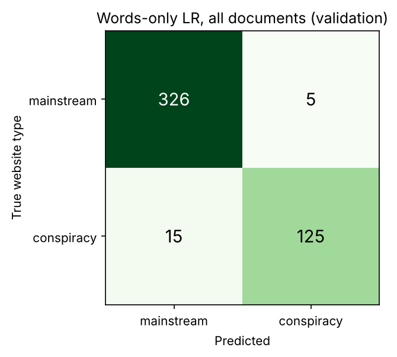
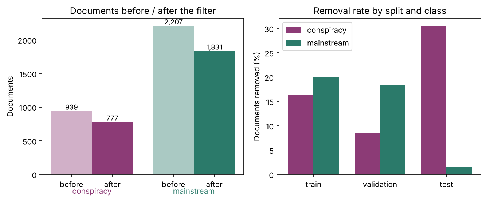
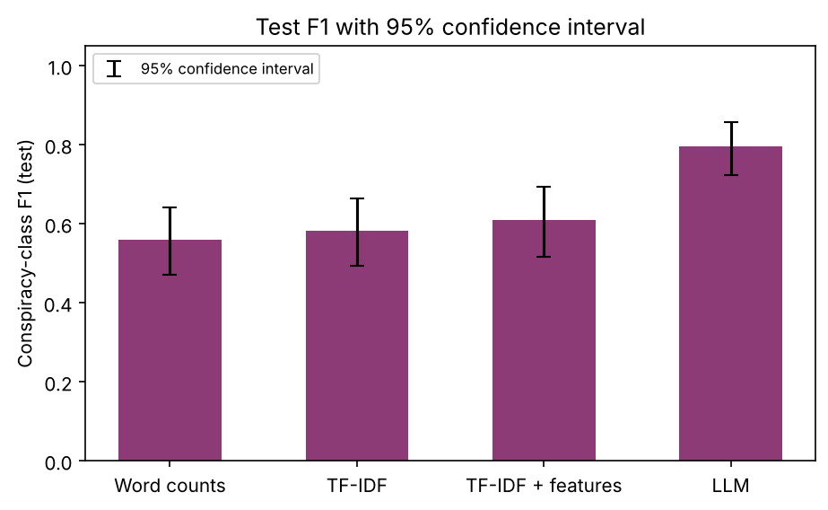
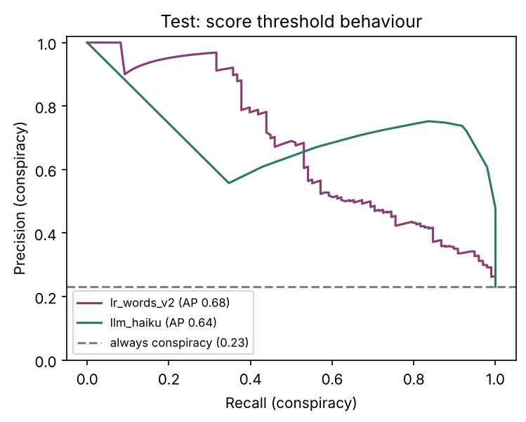

# Conspiracy or mainstream? A logistic regression and a cheap LLM classify full 9/11 articles by source website

All numbers in this report are copied from `results/metrics.json` and `results/tables/*.csv`. `tests/test_report_numbers.py` checks them. The code behind each step is explained in the walkthrough sections under `content/sections/`.

## 1. What we wanted to find out

News about a big event reaches us from very different kinds of websites. Some are mainstream outlets, some are websites that mainly promote conspiracy theories. We asked whether a machine can tell, from the **full text** of one article about the 9/11 attacks, which kind of website published it. We compared two very different approaches on exactly the same documents:

- a **logistic regression** (a simple model that gives each word a weight and adds the weights up) that we train ourselves, and
- **one cheap large language model (LLM)**, Claude Haiku 5.5, which is simply asked the question and never sees our training data.

The course feedback shaped the design: full articles instead of headlines, one cheap LLM instead of a benchmark, a small set of hand-made features, an honest look at cases where the model "fails" (the labels describe the website, not necessarily the article), and a description of how we used AI tools. It overrules the original proposal.

**Research questions**

- **RQ1.** How do a words-only logistic regression, a logistic regression with extra features, and a zero-shot LLM compare on the same test set, when whole websites are held out?
- **RQ2.** Do hand-made features help the logistic regression? Which groups help and which do not?
- **RQ3.** Where does each approach fail? For each disagreement with the dataset label, is the prediction implausible, or does the label not describe the text?

**Hypotheses.** They are listed in `docs/PROJECT_PLAN.md` (two commits, 2026-10-16 and 2026-10-17); the log does not prove they predate every result. Rule for H1–H4: the 95% confidence interval of the F1 difference (website bootstrap) lies entirely above 0. Effect sizes are rough expectations.

- **H1.** Both approaches beat the majority-class baseline (always "mainstream") on the F1 score of the conspiracy class. 
- **H2.** Two- and three-word phrases help more than any single non-word feature group. Expected: about +0.03 to +0.05 F1; the gain must also exceed that of each single non-word group.
- **H3.** Epistemic markers (words of certainty, doubt and "hidden truth") add signal beyond phrases. Expected: about +0.01 F1.
- **H4.** Style features (ALL CAPS, exclamation and question marks, quotation density, sentence length, repetition) add signal, but less than word-based features. Expected: about +0.01 to +0.02 F1, below the gain of H2.
- **H6.** An expectation, not a pre-registered claim (we cannot prove it predates the results): many false positives are mainstream articles that discuss or debunk conspiracy theories, and many false negatives are conspiracy-site articles that contain no conspiracy claim at all. Rule: descriptive; report the stance shares among errors.

There is no H5: the emotion-score idea was dropped (section 3) and the numbering keeps the gap.

## 2. Data, models and resources

**Corpus and labels.** We use the 9/11 subset of the LOCO corpus (Miani, Hills and Bangerter, 2022): 3,146 documents, 939 from 39 conspiracy-oriented websites and 2,207 from 79 mainstream websites. The label is the **subcorpus of the website**: it says what kind of site published the article, not what the article claims. A mainstream article that debunks a theory and a conspiracy-site article that reports plain news both carry their site's label. This is the central caveat of the project.

**Length.** The shortest article has 101 words and the median is 637.5. We apply no minimum length and report results by length bucket (section 5.5).

**Cleaning.** Website names, URLs and repeated boilerplate are removed from the text so that the model cannot read the answer off a site's signature. Two exact duplicates exist. They are dropped only inside the cleaned in-memory frame. We also found 63 near-duplicate pairs (cosine similarity at least 0.9); 36 lie across two splits, so a small leak is possible. We logged but did not remove them (open decision, section 6).

**The off-topic filter.** About one in six documents never mentions 9/11. The first words-only model therefore runs on all 3,146 documents; then only documents matching a list of 9/11 terms in title or text are kept. 2,608 remain (777 conspiracy, 1,831 mainstream) and all later experiments use them (section 5.2).

**Models.**

- Logistic regression with TF-IDF features (scikit-learn). TF-IDF turns each article into numbers: a word counts more if it is frequent in this article and rare in other articles.
- Claude Haiku 5.5 (`claude-haiku-5-5`), the cheapest model of the Claude 5 family, asked the **source question**: "does this article come from a conspiracy-oriented or a mainstream website?". Every article is cut to its first 3,000 words, the same for all documents. The answers are cached in `results/llm_cache.jsonl` (document id, prompt hash and answer, never article text), so `fml run-all` repeats without new API calls.

**Software.** Python 3.11.17, scikit-learn 1.9.1, pandas 3.0.6, numpy 2.4.6, scipy 1.17.1, matplotlib 3.11.2 and the `anthropic` client 1.15.0, pinned in `requirements-lock.txt`. `fml run-all` writes versions and run time to `results/run_info.json`. The seed is 20261016 (`config/project.yaml`).

**Licence status.** The LOCO paper states no licence for the texts, and the project page at the Open Science Framework was not reachable for the agent on 2026-10-16 or 2026-10-17 (access was blocked in its environment), so the licence is **not confirmed**. The recheck (requirement 7) is blocked and a team member must do it; see `docs/decisions.md`. We keep the texts in a private data repository, publish no article text, and this report contains no excerpts.

## 3. Approach

**One frozen split by website.** The split file `data/splits/split_v1.csv` was created once, grouped by website and stratified by label. *Grouped* means that all articles of one website go to the same part. The model never trains on a website and is then tested on more articles of the same website. This protects against a model that learns the style of a site instead of the style of conspiracy writing.

| Split | Conspiracy websites | Conspiracy documents | Mainstream websites | Mainstream documents |
|---|---|---|---|---|
| train | 25 | 658 | 54 | 1,546 |
| validation | 7 | 140 | 13 | 331 |
| test | 7 | 141 | 12 | 330 |

Every split has at least 3 conspiracy websites, so no split triggers the warning rule in our configuration. No website appears in two splits. The off-topic filter later drops rows at analysis time without editing the file.

**Step by step.**

1. A words-only TF-IDF logistic regression on all 3,146 documents (first run).
2. The off-topic filter, with before and after numbers.
3. The same model on the 2,608 filtered documents (baseline M1).
4. Three feature groups and an ablation: word n-grams of length 1 to 3 (such as "inside job"), epistemic markers (hedges, boosters, "hidden truth" and debunking words per 1,000 words) and style features. M2 uses all three; we also test each group alone and M2 with each group removed.
5. The LLM with three prompt variants, tried on validation only; the best conspiracy F1 on validation is fixed before any test document is classified.
6. One final test run per model, a second LLM pass for stability, and the comparison with confidence intervals.
7. An error analysis with stance coding.

**Fitting on training data only.** Vocabulary, IDF weights, scalers and all learned values are fitted on the training split. The regularisation strength C (how strongly large weights are penalised) and the class-weight setting are chosen on validation. `tests/test_leakage.py` fails if anything is fitted on more than the training data.

**What we did not do, and why.**

- *No fine-tuning and no multi-model benchmark.* The feedback asked for one logistic regression against one inexpensive LLM.
- *No emotion or sentiment features.* The team dropped them: emotional language is not automatically conspiracy language, especially for 9/11.
- *No LIWC.* It is a licensed dictionary; we used a short hand-picked epistemic list instead.
- *No tuning after seeing test results*, for example of the 150-token output limit.

## 4. Evaluation

**Read this first (four cautions about the test numbers).**

1. **Wide intervals, website level first.** The test set has 423 documents (98 conspiracy) from 18 websites, but only **6 conspiracy websites**. Documents from one website resemble each other, so the website (cluster) bootstrap interval is the honest one; the document interval is shown second and is too narrow.
2. **The words-only logistic regression was scored on test twice.** `results/test_access_log.jsonl` has `lr_words` and later `lr_words_v2` (a different configuration hash), after `lr_extended` and `llm_haiku` had been scored. The first configuration was stale and the lock forbids re-scoring one id with a new configuration, so the corrected model got a new id. **`lr_words_v2` is the reported words-only model; the `lr_words` result is not used for any number.**
3. **Six conspiracy websites.** One of them supplies 44 of the 98 conspiracy test documents, so the test set mostly measures how well each model recognises that site.
4. **36 near-duplicate pairs across splits** (`data.near_duplicate_pairs_across_splits`). Nine test documents have a partner in train or validation. The F1 changes by -0.005 (logistic regression) and -0.004 (LLM) without them, so they do not explain the result.

**What the conclusion rests on.** The words-only model got a second look on test when other test results were known (caution 2). The conclusion "the LLM beats the logistic regression" rests **only on the document-level test**: the McNemar test (p = 0.0004, 32 vs 9 documents that only one model gets right) and the document-bootstrap interval for delta-F1 (+0.0235 to +0.1795). At **website level the interval for the LLM-minus-LR F1 difference includes 0** (+0.0994, interval -0.0166 to +0.3891), so with 6 conspiracy websites the data cannot separate the two models. The without-near-duplicates numbers use saved predictions only; no new test scoring was done.

**Sensitivity row for the first `lr_words` configuration.** Its test numbers are not stored (the log keeps only id and hash) and we do not score on test again, so we give the **validation** comparison from `results/tables/comparison_lr_config_validation.csv` (`results/metrics.json#comparison.lr_config_validation_sensitivity`):

On validation the stale setting (C=100, no class weights) and `lr_words_v2` (C=10, balanced) both reach F1 0.914, so revising the configuration only changed the balance of precision (0.965 against 0.914) and recall (0.867 against 0.914).

The headline comparison on test is in section 5.5 (`results/tables/comparison_test.csv`, `results/tables/comparison_test_no_dups.csv`).

**Metrics.** *Precision* is the share of articles flagged as conspiracy that really come from conspiracy websites. *Recall* is the share of conspiracy-site articles that we catch. *F1* is the harmonic mean of the two. We report F1 for the conspiracy class, because about 70 percent of the documents are mainstream and a model that always answers "mainstream" would look good on accuracy while finding nothing.

**Confidence intervals.** A *95 percent confidence interval* is a range that would contain the true value in 95 of 100 repeated samples. We compute it by the *bootstrap* (2,000 resamples, seed 20261016): redraw the evaluation set with replacement and recompute the metric. The *document* bootstrap redraws documents; the *website* bootstrap redraws whole websites, which is more honest because documents from one site resemble each other. The website intervals are much wider and, with only 18 test websites (6 with conspiracy articles after filtering), are the ones to trust.

**McNemar test.** To ask whether two models differ on the same documents, we count documents only model A gets right and documents only model B gets right; McNemar's test asks whether these counts differ more than chance allows.

**Test set used once per model.** The test split is locked. Only `fml evaluate-final <model_id>` may score a model on it; it appends the model id, a configuration hash and the document count to `results/test_access_log.jsonl`, and a gate fails if one id is scored with two configurations. Three models count: `lr_words_v2`, `lr_extended` and `llm_haiku`. The stale `lr_words` entry (C 100, no class weights) stays in the log, unused. M2 is chosen over M1 only if its validation F1 gain has a website-bootstrap interval above 0.

The M1/M2 rule was applied to validation rows only (`ablation.chosen_lr`), but the log cannot prove it was fixed before any look. Now `evaluate_final` refuses a model whose validation-chosen configuration is not in `results/frozen_models.json`; earlier looks are marked `retroactive` there.

## 5. Findings

### 5.1 First run on all documents

The words-only model on all 3,146 documents reaches a validation F1 of 0.926 (document interval 0.892 to 0.957, website interval 0.791 to 0.957), with precision 0.962 and recall 0.893; the selected C is 100 with no class weights. No website name appears among the top 25 words per class, but blog vocabulary ("posted", "entry") is among the top conspiracy words, a style giveaway unrelated to 9/11.

### 5.2 The off-topic filter

The filter removes 538 of 3,146 documents, at almost the same rate in both classes (0.172 conspiracy, 0.170 mainstream; Fisher exact test p = 0.877). The removed mainstream articles come mostly from health and nature websites and are real off-topic text. The removal is uneven across splits (0.189 of training, 0.155 of validation and 0.102 of test documents), and two conspiracy websites lose all their documents.

| Setting | Documents | Conspiracy | Precision | Recall | F1 |
|---|---|---|---|---|---|
| A: all-documents model on all validation documents | 471 | 140 | 0.962 | 0.893 | 0.926 |
| B: all-documents model on filtered validation documents | 398 | 128 | 0.959 | 0.914 | 0.936 |
| C: filtered model on filtered validation documents | 398 | 128 | 0.914 | 0.914 | 0.914 |

The validation sets of rows A and C differ, so those F1 values are not directly comparable; row B scores the first model on exactly the documents of row C. Filtering did not improve validation F1 (row C minus row B is -0.022). We keep the filter as a team decision: articles that never mention 9/11 do not belong to the topic. 
### 5.3 Do the extra features help? (RQ2)

All values below are validation results on 398 filtered documents from 19 websites. The last column is the F1 change against words only, with the website-bootstrap interval.

| Model | Precision | Recall | F1 | Change vs words | Website interval | Verdict |
|---|---|---|---|---|---|---|
| M1: words | 0.914 | 0.914 | 0.914 | | | reference |
| + n-grams (1-3) | 0.943 | 0.898 | 0.92 | 0.006 | -0.017 to 0.050 | no clear gain |
| + epistemic | 0.944 | 0.922 | 0.933 | 0.019 | -0.010 to 0.085 | no clear gain |
| + style | 0.921 | 0.906 | 0.913 | -0.001 | -0.043 to 0.056 | no clear gain |
| M2: all three | 0.948 | 0.859 | 0.902 | -0.012 | -0.061 to 0.073 | no clear gain |

No feature group gives a clear gain, and the full extended model is not better than words alone. H2, H3 and H4 are therefore **not supported** on validation: the intervals all include 0. The best single number (epistemic markers, +0.019) lies inside the noise. By the rule fixed in advance, M1 (`lr_words_v2`, C 10, balanced class weights) is the chosen logistic regression.

**Why these groups.** Word and bigram features are a strong linear baseline (Wang and Manning, 2012), so H2 expected the largest gain. Conspiracy discourse is marked by hidden-truth vocabulary (Marini and Jezek, 2024), so H3 is a real test. Style features generalise poorly across domains (Perez-Rosas et al., 2018), so H4 expected a small gain at best.

The feature table shows that some groups do separate the classes in the training data. Hidden-truth vocabulary is far more frequent on conspiracy websites (mean 1.091 per 1,000 words against 0.055), as are boosters and exclamation marks. The words already carry this signal, so the extra counts add little.

### 5.4 The LLM (part of RQ1)

We tried three prompt variants on the same 398 validation documents.

| Variant | Prompt words | Precision | Recall | F1 | Unreadable answers | Cost (USD) |
|---|---|---|---|---|---|---|
| v1 | 42 | 1.0 | 0.758 | 0.862 | 64 | 0.107 |
| v2 | 102 | 1.0 | 0.906 | 0.951 | 44 | 0.11 |
| v3 | 107 | 1.0 | 0.688 | 0.815 | 91 | 0.114 |

Variant v2 is chosen by the fixed rule (highest validation F1). All three variants have precision 1.0 on validation, so the differences come from recall. Part of the loss comes from answers cut off by the 150-token output limit; we count these as "mainstream", which lowers recall.

**Stability.** The `claude-haiku-5-5` interface returns an error for the temperature parameter, so we used default sampling and recorded the conflict with our rule "temperature 0" in `docs/decisions.md`. A second pass over the 423 test documents agrees on 0.950 of them (21 flip; Cohen's kappa 0.887). Pass 1 is scored; pass 2 gives the same F1 (0.684), so the instability is small.

### 5.5 Head-to-head on the test set (RQ1)

| Model | Precision | Recall | F1 | F1 document interval | F1 website interval | Macro F1 | Balanced accuracy |
|---|---|---|---|---|---|---|---|
| Majority class | 0.0 | 0.0 | 0.0 | 0.0 to 0.0 | 0.0 to 0.0 | 0.434 | 0.5 |
| Logistic regression, words (`lr_words_v2`) | 0.685 | 0.510 | 0.585 | 0.491 to 0.667 | 0.324 to 0.804 | 0.740 | 0.720 |
| Logistic regression, extended (`lr_extended`) | 0.662 | 0.520 | 0.583 | 0.493 to 0.667 | 0.314 to 0.822 | 0.737 | 0.720 |
| Claude Haiku 5.5 (`llm_haiku`) | 0.963 | 0.531 | 0.684 | 0.592 to 0.762 | 0.371 to 0.933 | 0.807 | 0.762 |

The test set has 423 documents (98 conspiracy) from 18 websites.

**H1 is supported.** Both approaches beat the majority baseline; the website-bootstrap intervals exclude 0 (LLM 0.371 to 0.933, logistic regression 0.324 to 0.804).

**The LLM scores higher than the chosen logistic regression on documents, but the website-level evidence is not conclusive.** Among the 423 test documents, 32 are right only for the LLM and 9 are right only for the logistic regression, 343 are right for both and 39 are wrong for both. McNemar's test gives p = 0.0004. The F1 difference is 0.099 (document interval 0.024 to 0.179). The website interval, however, is -0.017 to 0.389 and includes 0. With only 6 conspiracy websites, equal models cannot be ruled out. The models make different mistakes. The LLM almost never flags a mainstream article (accuracy on mainstream articles 0.994, against 0.929) but misses about half of the conspiracy articles; the logistic regression produces 23 false positives against 2.

**The extended model is not better on test either.** Its F1 is 0.583 against 0.585 (McNemar p = 0.868; website interval of the difference -0.115 to 0.097).

**Validation numbers do not carry over to test.** The logistic regression drops from 0.914 to 0.585 and the LLM from 0.951 to 0.684. One conspiracy site contributes 44 of the 98 conspiracy test documents; the models recognise only 0.204 (both logistic regressions) and 0.159 (LLM) of them, while several other conspiracy sites reach 0.579 to 0.895 (leaving out a site with one document). The test set thus mostly measures how well we recognise this one site.

**Length.** Results by length bucket on test (F1 of the conspiracy class):

| Length | Documents | Conspiracy | Logistic regression, words | Logistic regression, extended | LLM |
|---|---|---|---|---|---|
| 0-149 words | 27 | 5 | 0.5 | 0.5 | 1.0 |
| 150-249 words | 32 | 7 | 0.615 | 0.667 | 0.727 |
| >= 250 words | 364 | 86 | 0.587 | 0.581 | 0.656 |

The short buckets hold too few conspiracy documents for a conclusion.

**Near-duplicates.** Without the nine test documents that have a near-duplicate partner in train or validation (414 left), F1 is 0.580 for the logistic regression and 0.68 for the LLM, so the conclusion does not change.

### 5.6 Error analysis (RQ3, H6)

On test, the logistic regression is wrong alone on 32 documents (22 false positives, 10 false negatives), the LLM alone on 9, and both are wrong on 39 (38 of them false negatives). Claude Sonnet 5.5 coded the stance of these 80 articles towards a 9/11 conspiracy claim (endorses, rejects or debunks, reports neutrally, or makes no claim). Two answers could not be parsed, leaving 78 usable; the "Unparsed" column holds those two. By a fixed rule, a conspiracy-site article that rejects, reports neutrally or makes no claim, and a mainstream-site article that endorses, are classed as "label does not describe the text"; all other errors are "model wrong".

| Disagreement set | Errors | Model wrong | Label does not describe the text | Unparsed |
|---|---|---|---|---|
| Logistic regression only wrong | 32 | 21 | 10 | 1 |
| LLM only wrong | 9 | 2 | 7 | 0 |
| Both wrong | 39 | 1 | 37 | 1 |
| All | 80 | 24 | 54 | 2 |

By stance, 62 articles make no claim, 9 report neutrally, 3 endorse a conspiracy claim and 4 reject or debunk. For the **false negatives**, the answer to H6 is clear: of the missed conspiracy-site articles, the share with no conspiracy claim is 0.873 and the share that do not endorse a claim is 0.964. Many only mention 9/11 in passing, so a model that missed them was arguably right. For the **false positives** the picture is mixed: of the mainstream articles flagged as conspiracy, 0.348 discuss conspiracy theories without endorsing them, but only 0.130 debunk them, so most false positives are plain model errors (22 of 24). The share of errors that are label problems ranges from 0.286 to 0.692, provisional (Claude-coded, not human-verified) (`errors.label_problem_range`), depending on how unparsed replies and non-decisive codes are counted. The whole range rests on Claude-written stance codes that no human has checked (kappa = null; `fml stance-agreement` prints `pending: 0/40 filled`). Once a teammate fills the 40-row human sample and kappa is computed, these shares may move: if the human codes agree with Claude's, the range stands and loses the label; if humans read more of the vague `no_claim` and `reports_neutrally` articles as conspiracy content, the shares fall toward the low end or below it.

Two short examples (Claude's scrubbed stance justifications; full articles stay in the private data repo under the `doc_id`):

> Mainstream false positive, doc_id M07f55: "The article criticizes 9/11 conspiracy theories as incoherent and implausibly intricate, and calls them a 'non-issue' used by Russia [name]."

> Conspiracy-site false negative, doc_id C0051b: "The article covers a [name] statue at the WTC site and lawsuits alleging Saudi support for al-Qaeda. Those are litigation allegations, not an inside-job"

**H6 is supported for false negatives and only partly for false positives.** The finding is provisional: the stance codes come from Claude and have not been checked by a person (section 6).

**Status of the human stance check: blocked, pending human check.** The column `human_stance` in `results/tables/stance_check_sample.csv` is blank for all 40 rows, Cohen's kappa was not computed (`null`, not 0), and H6 has not been tested by humans. To close it, Members A and B fill `human_stance` independently, run `fml stance-agreement`, and copy the kappa into the H6 verdict here and in section 11.

## 6. Interpretation and limitations

**What the results say.** Both approaches work well on validation and much less well on test, which asks for generalisation to unseen websites. The LLM is almost never wrong about mainstream articles, and its recall is limited by articles that do not look like conspiracy writing. The logistic regression is cheaper per document, but it learns blog style and misclassifies some mainstream sites. Hand-made features did not help beyond chance.

**Label versus content.** The labels describe websites. Between 0.286 and 0.692 (provisional (Claude-coded, not human-verified)) of the coded errors are articles a reader would not call conspiracy content (section 5.6), but this rests on Claude-coded stance that humans have not checked. If it holds, the limit of this task is the match between site label and article text, not model strength.

**Noise and sample size.** The test split has 6 conspiracy websites after filtering, and 44 of its 98 conspiracy documents come from one site, so single sites move the result. The split is frozen and was not repaired.

**The website name.** No site name is among the top coefficients, but style, such as blog formatting, may still identify a **type** of website. Near-duplicates across splits (36 pairs) could leak some information; dropping the 9 affected test documents barely changes F1 (section 5.5).

**LLM prior knowledge.** Haiku 5.5 may know some of these websites from its training. We ran a probe on validation only: Haiku was asked to name the website of a seeded sample of 40 validation articles (the prompt gives the cleaned article text, not only the title; only a yes/no match is stored). It named the true site for 5 of 40 articles (12.5%; `errors.prior_knowledge_probe` in `results/metrics.json`). The sample is small, so this does not rule out that the LLM's score partly reflects memorised site reputations.

**LLM output limits.** Between 44 and 91 of 398 validation answers per prompt variant, and 61 of 423 test answers, could not be parsed, which lowers recall. Every unparsed answer used the full 150 output tokens (`metrics.json#llm.parse_error_causes`), so truncation is the likely cause (inferred; no raw replies are cached). A larger limit would be a new run with a new model id and needs a team decision; the earlier 400-token check never applied 400 tokens, so it is no evidence.

**Lexicon weakness.** The epistemic list is short, hand-made and ignores negation ("no evidence of cover-up" counts "cover-up"), so the negative result for H3 should not be generalised. Making the counts negation-aware changed validation F1 by 0.000 (`results/tables/epistemic_negation.csv`); the verdict stays "no clear gain".

## 7. Use of AI tools

**What the AI produced.** Claude (Opus 5.5) in a chat session with the repository owner produced the project plan with the literature research, the agent harness, the site generator, the checksummed data subset and the repository rules. In cycle 1 an AI coding agent (Claude Code, Sonnet 5.5) wrote the analysis code, tests, result tables, walkthrough sections and this report, one task at a time. Claude Haiku 5.5 is the classifier under study, and Claude Sonnet 5.5 coded article stance. The team (Members A to E) decided what to study: full articles, one cheap LLM, the feature groups, the off-topic filter, a public repository with private data, and the pull-request cycles.

**What was checked, and what caught problems.** Automatic **gates** run after each task and fail if a rule breaks: section format, the frozen split, the test-access log, report length, privacy, copied article text and protected paths. **Tests** encode why a rule matters; for example, fitting on more than the training data makes the leakage test fail. The data subset was checked against the LOCO paper's counts (3,146 = 939 + 2,207). The checks found:

- The plan said no duplicates exist; there are two exact duplicates and 63 near-duplicate pairs.
- About one in six documents never mention 9/11, which became the off-topic filter.
- The LLM refuses the temperature setting our rules required; the conflict was recorded and its effect measured.
- Two interrupted parallel runs duplicated cache lines; the cache reader was repaired.
- The agent first claimed truncation was not the cause of unparsed LLM answers; `docs/decisions.md` retracts the claim.
- A stale `lr_words` configuration was scored on test first; the corrected model got a new id (`lr_words_v2`), and `evaluate_final` now requires a validation-frozen configuration.

These corrections are documented in `docs/ai-log.md` and `docs/decisions.md`; they were found by checking the agent's output against the data. Further human corrections are pending: no person has signed off a check yet.

**Automated versus human checks.** `tests/test_report_numbers.py` and `tests/test_section_numbers.py` check that every number in the report and in sections 05, 08 and 10 appears in `results/` or the config. That is an automated check, not a human one, and it does not show that a number is the right metric. `docs/ai-log.md` lists seven human checks, each with a placeholder owner (Member A–E); the agent does not sign them off. 
**What is skipped or still open (human checks outstanding).** All seven human checks are pending: the numbers spot-check, the stance codes, the licence, the temperature decision, the output-limit and near-duplicate decisions, the privacy read and the double test access. Two course-feedback items are blocked on a person, not declined: the human stance check (requirement 2; the agent cannot supply human labels, so kappa is null and the H6 verdict is provisional) and the licence recheck (requirement 7; the agent could not open the page, so the texts stay private). The temperature and output-limit decisions in `docs/decisions.md` show "Confirmation: pending" with the conservative reading used meanwhile (default sampling; 150 tokens kept, unparsed answers counted as errors).

## References

- Miani, A., Hills, T., and Bangerter, A. (2022). LOCO: The 88-million-word language of conspiracy corpus. *Behavior Research Methods*, 54. https://doi.org/10.3758/s13428-021-01698-z
- Pedregosa, F. et al. (2011). Scikit-learn: Machine learning in Python. *Journal of Machine Learning Research*, 12, 2825-2830.
- McNemar, Q. (1947). Note on the sampling error of the difference between correlated proportions or percentages. *Psychometrika*, 12, 153-157.
- Efron, B. (1979). Bootstrap methods: Another look at the jackknife. *Annals of Statistics*, 7, 1-26.
- Wang, S., and Manning, C. D. (2012). Baselines and bigrams: Simple, good sentiment and topic classification. *Proceedings of ACL (Short Papers)*. https://aclanthology.org/P12-2018
- Marini, C., and Jezek, E. (2024). What to annotate: Retrieving lexical markers of conspiracy discourse from an Italian-English corpus of Telegram data. *ISA-20 Workshop*. https://aclanthology.org/2024.isa-1.6
- Horne, B. D., and Adali, S. (2017). This just in: Fake news packs a lot in title, uses simpler, repetitive content in text body, more similar to satire than real news. *ICWSM Workshops*. https://arxiv.org/abs/1703.09398
- Perez-Rosas, V., Kleinberg, B., Lefevre, A., and Mihalcea, R. (2018). Automatic detection of fake news. *Proceedings of COLING*. https://arxiv.org/abs/1708.07104
