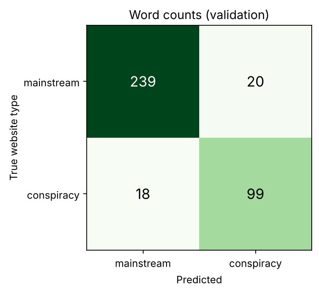
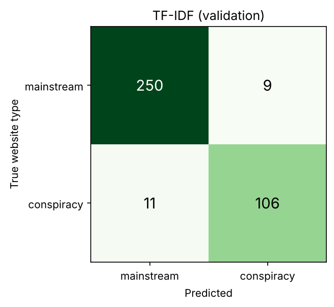
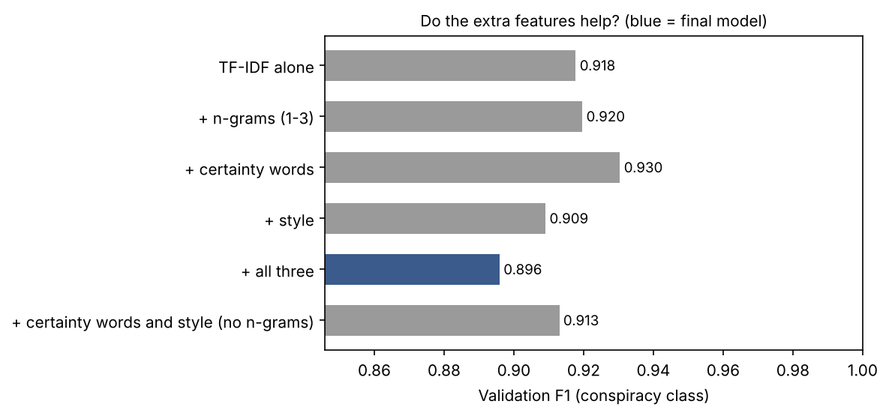
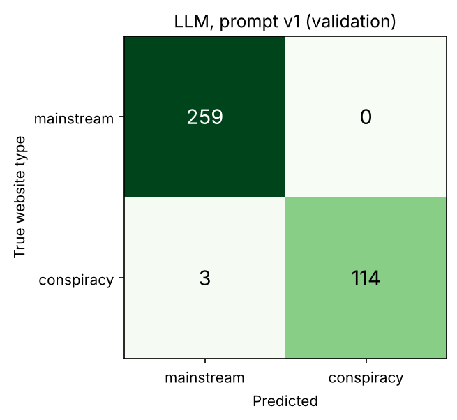
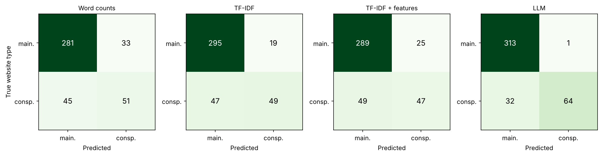
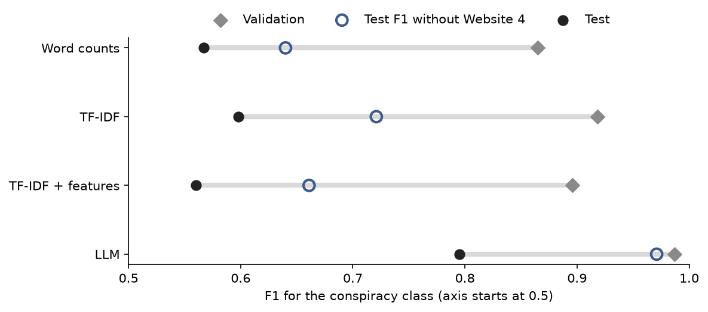

# Conspiracy or mainstream? Classifying 9/11 articles with logistic regression and an LLM

## Question and hypotheses

### Executive summary

We asked whether the text of a full 9/11 article reveals whether it was published on a conspiracy-oriented or a mainstream website. Four methods were compared in a demanding but fair test: every website appears in only one of the training, validation and test sets. On validation all four looked excellent (F1 from 0.865 to 0.987). On the 410 test articles from unseen websites all four dropped sharply, above all because of one website, Website 4, which supplies 44 of the 96 conspiracy test articles and whose texts read like ordinary political news. The language model Claude Haiku 5.5 stayed best (F1 0.795 against 0.598 for TF-IDF): weighting words helped narrowly (H1 supported), hand-made features did not help (H2 not supported) and the language model won (H3 supported). The main lesson concerns the data: with website labels and few conspiracy websites, an honest test reaches the limits of the data set before those of any method.

### Introduction

The attacks of 11 September 2001 are a persistent subject of conspiracy theories: claims that they were an "inside job", a "controlled demolition" or a "false flag" are actively argued for online (Wood & Douglas, 2013). In a 2006 survey, 36 percent of Americans found it credible that federal officials helped the attacks happen or deliberately failed to stop them (Stempel, Hargrove & Stempel, 2007). This study asks whether the text of a full 9/11 article reveals if it was published on a conspiracy-oriented or a mainstream website, using machine-learning methods for text classification.

We compare four methods that form a ladder from simple to rich: logistic regression on word counts, the plainest baseline; logistic regression on TF-IDF weights, the standard step beyond counting (Salton & Buckley, 1988; Manning, Raghavan & Schütze, 2008); logistic regression on TF-IDF plus three groups of hand-made features; and a low-cost LLM used without training (zero-shot). The four method chapters follow the same pattern: the idea and what we expected, the setup, the result on validation, and what the model learned. We test three hypotheses:

- **H1.** TF-IDF reaches a higher F1 than word counts, because distinctive words carry more information than common ones.
- **H2.** TF-IDF plus the three feature groups reaches a higher F1 than TF-IDF alone, because these features capture how conspiracy texts argue.
- **H3.** The LLM reaches a higher F1 than the best logistic regression, because it brings broad knowledge of how texts are written.

Compared with the original proposal, we classify full articles instead of headlines, because a headline may mention a conspiracy without showing whether the article supports it, and we use one inexpensive language model without fine-tuning, as the course feedback advised. All methods read the same first 3,000 words of each article, and everything except the language model runs on an ordinary computer in about four minutes.

What we left out, and why: other classifiers, because the question is about the input; emotion features, because fear and anger are normal in any report on an attack; and a transfer test on other topics, to keep one topic.

| Method | Input | Trained on our data | Settings | Runtime | Cost |
|---|---|---|---|---|---|
| 1. Word counts + logistic regression | word counts | yes | C from [0.01, 0.1, 1, 10, 100], class weight balanced, chosen on validation | a few seconds | free (runs locally) |
| 2. TF-IDF + logistic regression | TF-IDF weights | yes | C from [0.01, 0.1, 1, 10, 100], class weight balanced, chosen on validation | a few seconds | free (runs locally) |
| 3. TF-IDF + features + logistic regression | TF-IDF weights, n-grams, certainty words, style | yes | C from [0.01, 0.1, 1, 10, 100], class weight balanced, chosen on validation | about 3 minutes | free (runs locally) |
| 4. LLM (claude-haiku-5-5) | the article text itself, with a written question | no | prompt v1 of 3, default sampling | about 1.0 seconds per article | about $0.26 per 1,000 articles |

*The four methods at a glance*

### How we judge the methods

Most articles are mainstream, so accuracy would reward a model that never finds a conspiracy article. All methods are therefore judged by precision (how many flagged articles are conspiracy), recall (how many conspiracy articles are found) and their combination F1, all for the conspiracy class. Two models are compared with McNemar's test, which counts the articles that exactly one of them gets right, from both classes (Dietterich, 1998). A hypothesis is supported only when both point the predicted way: F1 is higher and p < 0.05. The three tests are not corrected for multiple testing; with a correction for three tests (0.05/3) only H3 would still pass.

## Data and cleaning

**Source.** The study uses the 9/11 subset of the LOCO corpus (Miani, Hills & Bangerter, 2022), a collection of web pages from websites rated as conspiracy-oriented or mainstream: 3,146 documents from 39 conspiracy and 79 mainstream websites. Each document carries the label of its website, so the label describes the publisher and not the single text; in the corpus authors' own blind check of 60 documents per subcorpus, 85% of the conspiracy and 92% of the mainstream documents fitted their label. The texts belong to their publishers and no licence terms could be confirmed, so the data stay in a private repository and this report shows only counts and short excerpts. The work used Python 3.11.17 with pandas, scikit-learn 1.9.1 (Pedregosa et al., 2011) and the Anthropic client library 1.15.0.

**Cleaning.** A classifier takes the easiest signal that separates the classes; this shortcut learning (Geirhos et al., 2020), a form of target leakage (Kaufman et al., 2012), arises when site names, boilerplate, topics or copies reveal the label. All cleaning therefore came before any model. First, documents were kept only if their title or text contains at least one of ten search terms or a spelling variant (9/11, nine eleven, September 11, Twin Towers, World Trade Center, WTC, Pentagon, al-Qaeda, bin Laden, Ground Zero): 538 documents were removed, because a model could otherwise learn topics instead of kinds of websites. Second, near-duplicates (a cosine similarity of their TF-IDF vectors of at least 0.9) were removed, so that no model meets a copy of a test article in training; the copy in the earlier set (training, then validation, then test) was kept. Third, web addresses, e-mail addresses, website names and lines repeated across one website's documents were deleted; this edited 2,498 texts and removed none.

| Step | Removed | Remaining | Conspiracy removed | Mainstream removed | Conspiracy remaining | Mainstream remaining |
|---|---|---|---|---|---|---|
| all documents | 0 | 3146 | 0 | 0 | 939 | 2207 |
| off-topic articles removed | 538 | 2608 | 162 | 376 | 777 | 1831 |
| near-duplicates removed | 54 | 2554 | 22 | 32 | 755 | 1799 |

*Documents before and after each cleaning step*

**Result.** After cleaning, 2,554 documents from 37 conspiracy and 79 mainstream websites remain: 755 conspiracy and 1,799 mainstream articles, so the classes are unbalanced. Two conspiracy websites lost all their documents. The data are also concentrated: the three largest conspiracy websites supply 157 articles, 20.8% of all 755 conspiracy articles.

## Splitting by website

**Why by website.** Articles from one website resemble each other in topics, phrasing and layout. If a website appeared in both the training and the test set, a model could score well by recognising the website instead of the kind of text, a form of leakage (Kaufman et al., 2012); features that look strong within known sources often transfer poorly to new ones (Pérez-Rosas et al., 2018). Holding out whole sources is the standard way to test whether a classifier generalises, so we kept this demanding design throughout, even where it cost us scores.

**How.** The documents were divided into training, validation and test sets with target shares of 70%, 15% and 15%, so that no website appears in more than one set. The division was stratified by label: conspiracy and mainstream websites were assigned separately, from the largest to the smallest website, to the set furthest short of its target share, with a fixed random seed for ties. The assignment was made once and never changed.

| Set | Class | Websites | Documents | Share of documents |
|---|---|---|---|---|
| train | conspiracy | 25 | 542 | 0.212 |
| train | mainstream | 54 | 1226 | 0.48 |
| validation | conspiracy | 6 | 117 | 0.046 |
| validation | mainstream | 13 | 259 | 0.101 |
| test | conspiracy | 6 | 96 | 0.038 |
| test | mainstream | 12 | 314 | 0.123 |

*Websites and documents per set and class, after cleaning*

**Consequence.** The sets are small in websites rather than in articles: validation and test contain only 6 conspiracy websites each. A single large website can therefore shape a whole score, which is exactly what happens in the test set.

## Word counts

**Idea.** The first method is the plainest baseline. Each article becomes a bag of words: the number of times each word occurs, ignoring order. Logistic regression (Hastie, Tibshirani and Friedman, 2009) gives each word a weight, adds the weights of an article's words and turns the sum into a probability that the article comes from a conspiracy website; above 0.5 it predicts conspiracy. We expected it to beat always guessing mainstream, because the two kinds of website use different words.

**Setup.** The same setup holds for all three logistic regressions. The vocabulary and every other learned quantity come from the training articles only, and a word must occur in at least two of them (23,635 words). Class weights are balanced, because conspiracy articles are the smaller group. The regularisation strength C, which pulls the weights towards zero and so keeps the model from memorising single articles (Hastie, Tibshirani and Friedman, 2009, ch. 4), was chosen from {0.01, 0.1, 1, 10, 100} by validation F1.

**Validation result.** The strongest regularisation, C = 0.01, scored best: precision 0.828, recall 0.906 and F1 0.865. The model found 106 of the 117 conspiracy articles and called 22 of the 259 mainstream articles conspiracy. Weaker regularisation scored lower (F1 0.791 at C = 100), the typical sign of overfitting.

**What it learned.** The strongest words are partly about content ("truth", "cia") and partly about presentation: "posted" and "am" sound like blog posts, "says" and "killed" like news reports. The model therefore partly learns how the training websites write, a first hint of why new websites will be harder.

## TF-IDF

**Idea.** TF-IDF keeps the bag of words but weights each count by how rare the word is across the training articles (Salton and Buckley, 1988; Manning, Raghavan and Schütze, 2008): everyday words such as "said" count little, rare and telling words count more. H1 expects this to beat plain counts.

**Setup.** As for word counts. In addition, counts are damped with a logarithm, each article vector is scaled to unit length, and the rarity weights are computed on the training articles only.

**Validation result.** C = 10 scored best: precision 0.930, recall 0.906 and F1 0.918. The model found the same 106 of 117 conspiracy articles as word counts but raised only 8 false alarms instead of 22, so the whole gain is in precision. A larger C suits TF-IDF because its values are small numbers that need larger weights.

**What it learned.** The strongest words barely change: "posted", "truth" and "article" point to conspiracy websites, "killed", "tower" and "york" to mainstream ones. TF-IDF reduces noise rather than finding new signals.

## TF-IDF plus extra features

**Idea.** The third method tests H2: whether hand-made features add what single words miss. Three groups were planned before any result. N-grams are phrases of one to three words such as "no evidence of", a strong baseline for text classification (Wang and Manning, 2012). Epistemic markers are counts per 1,000 words of four short lists of doubt, certainty, hidden-truth and debunking words, following work that ties conspiracy discourse to certainty and concealment (Marini and Jezek, 2024; Islam et al., 2020; but see Fong et al., 2021). Style features are capitals, punctuation, quotation marks, sentence length and word variety (MATTR), which separated fake from real news in earlier work (Horne and Adali, 2017) but transfer poorly across domains (Pérez-Rosas et al., 2018).

**Setup.** As for TF-IDF; the numeric groups are standardised with training statistics only. Phrases must occur in at least three training articles, single words in at least two, because phrases are far more numerous: with two, the planned model fills the cap of 200,000 phrase columns and its validation F1 falls to 0.891. To explain the result, an ablation compares six models on validation: TF-IDF alone, with each group, with all three, and with certainty words and style but no n-grams.

| Model | Validation F1 |
|---|---|
| TF-IDF alone | 0.918 |
| + n-grams (1-3) | 0.920 |
| + certainty words | 0.930 |
| + style | 0.909 |
| + all three groups | 0.896 |
| + certainty words and style (no n-grams) | 0.913 |

**Validation result.** The planned model with all three groups scored 0.896, below TF-IDF alone (0.918); certainty words alone scored highest (0.930). A difference of one or two hundredths is one or two of the 117 conspiracy articles. H2 concerns the planned combination, and switching to the best single row after seeing the table would bend the hypothesis to the results, so the planned model was kept.

**What it learned: why the features could work, and why they did not.** The features do separate the classes in the training data: hidden-truth phrases such as *cover-up* appear in 44% of conspiracy and 3% of mainstream articles. Four likely reasons, not tested causes, explain why they added nothing. First, too many variables for too few examples: the full model has 146,172 columns for 1,768 training articles, so it can fit single articles, and it chose the weakest regularisation in the grid (C = 100). Second, overlap: TF-IDF already holds most list words, and "truth" is its second-strongest conspiracy word. Third, style habits such as capitals may describe single websites rather than conspiracy writing, and do not carry over to new websites. Fourth, word lists ignore context: debunking words appear in 26% of conspiracy and 10% of mainstream articles, because conspiracy texts argue against debunkers.

## The LLM classifier

**Idea.** The fourth method trains nothing. Claude Haiku 5.5, the lowest-cost model of Anthropic's Claude 5.5 family, receives each article with one question, whether it would have been published on a conspiracy-oriented or a mainstream website, and no examples (zero-shot). H3 expects it to beat the best logistic regression, because it brings broad knowledge of how texts are written.

**Setup.** One request per article went through Anthropic's API in October 2026 with the first 3,000 words as for all methods, default sampling (the model has no temperature setting) and a fixed short answer (label, confidence, one-line reason) of at most 1,000 tokens. The cost was about $0.26 per 1,000 articles. Answers are stored in results/llm_cache.jsonl, so reruns make no new calls. Three prompts were tried on validation only: the bare question (v1), the question with definitions of both website types (v2), and a step-by-step version that warns against judging by topic (v3).

| Prompt | Articles | Precision | Recall | F1 |
|---|---|---|---|---|
| v1 | 376 | 1.0 | 0.974 | 0.987 |
| v2 | 376 | 1.0 | 0.966 | 0.983 |
| v3 | 376 | 1.0 | 0.974 | 0.987 |

**Validation result.** The three prompts differ by one article (F1 0.987, 0.983 and 0.987); with a tie, the first prompt, v1, was kept. It reached a precision of 1.000 and a recall of 0.974: it found 114 of the 117 conspiracy articles and raised no false alarm. A repeated run gave the same answer for 0.992 of the articles.

**What it learned.** Nothing from our data, which is its strength and its risk. It is scored against website labels, so a "wrong" answer may be a correct reading of a text whose website label does not fit it; and it may recognise websites from its own training, which the logistic regressions cannot. The test shows how much of its lead survives on new websites.

## Results and why they fail

### Test scores

All four final models were scored once on the same 410 test articles (96 conspiracy) from websites that no model had seen. The 95% bootstrap intervals (Efron and Tibshirani, 1993) treat articles as independent, although articles from one website are alike, so the real uncertainty is larger. Always answering "mainstream" reaches an accuracy of 0.766 and finds no conspiracy article.

| Model | Precision | Recall | F1 |
|---|---|---|---|
| Word counts | 0.607 (0.500 to 0.714) | 0.531 (0.434 to 0.631) | 0.567 (0.478 to 0.650) |
| TF-IDF | 0.721 (0.614 to 0.824) | 0.510 (0.413 to 0.615) | 0.598 (0.508 to 0.682) |
| TF-IDF + features | 0.653 (0.542 to 0.767) | 0.490 (0.394 to 0.590) | 0.560 (0.469 to 0.643) |
| LLM | 0.985 (0.949 to 1.000) | 0.667 (0.570 to 0.759) | 0.795 (0.723 to 0.857) |
| Always guess mainstream | 0.000 | 0.000 | 0.000 |

*Precision, recall and F1 of the conspiracy class on the test articles, with 95% confidence intervals*

The LLM leads clearly. All four models mainly miss conspiracy articles: the logistic regressions find 51, 49 and 47 of the 96, the LLM 64. They differ in false alarms: 33 for word counts, 19 for TF-IDF, 25 for TF-IDF + features and 1 for the LLM, whose precision is 0.985.

### Hypotheses

Each pair is compared with an exact two-sided McNemar test (McNemar, 1947) on the articles where only one of the two models is right.

| First model | Second model | Right only for the first | Right only for the second | p-value |
|---|---|---|---|---|
| Word counts | TF-IDF | 7 | 19 | 0.029 |
| TF-IDF | TF-IDF + features | 22 | 14 | 0.243 |
| TF-IDF | LLM | 4 | 37 | < 0.0001 |

*The three McNemar tests: articles where only one model is right, and the p-value*

**H1: TF-IDF beats word counts.** Supported, narrowly: 7 articles are right only for word counts and 19 only for TF-IDF (p = 0.029), and TF-IDF has the higher F1 (0.598 against 0.567), mainly through fewer false alarms.

**H2: The three feature groups improve TF-IDF.** Not supported: 22 articles are right only for TF-IDF and 14 only with the features (p = 0.243), and F1 is lower with the features (0.560 against 0.598), as on validation.

**H3: The LLM beats the best logistic regression.** Supported: 4 articles are right only for TF-IDF and 37 only for the LLM (p < 0.0001); F1 is 0.795 against 0.598 and the intervals do not overlap. For all three tests F1 and McNemar point the same way.

### Why test scores are lower: Website 4

Every model scores far lower on test than on validation:

The main cause is one website. Website 4 supplies 44 of the 96 conspiracy test articles, and all four models find at most a third of them (recall 0.205 to 0.318), while the LLM finds at least 0.947 of the articles on every other test website with more than one article.

| Website | Test articles | Recall: Word counts | Recall: TF-IDF | Recall: TF-IDF + features | Recall: LLM |
|---|---|---|---|---|---|
| Website 1 | 19 | 0.684 | 0.579 | 0.684 | 0.947 |
| Website 2 | 6 | 0.833 | 0.833 | 0.833 | 1.000 |
| Website 3 | 19 | 0.789 | 0.842 | 0.737 | 0.947 |
| Website 4 | 44 | 0.250 | 0.205 | 0.205 | 0.318 |
| Website 5 | 1 | 1.000 | 1.000 | 1.000 | 1.000 |
| Website 6 | 7 | 0.857 | 1.000 | 0.714 | 1.000 |

*Recall of each model on the conspiracy articles of each test website (Website 4 holds 44 of the 96)*

Without Website 4 the F1 is 0.640 for word counts, 0.721 for TF-IDF, 0.661 for TF-IDF + features and 0.971 for the LLM. For the LLM, Website 4 explains almost the whole drop (0.971 against 0.987 on validation). For the logistic regressions it is the largest single cause, but they stay well below their validation scores, which fits their partial reliance on how the training websites write. Judging by its titles, Website 4 publishes short partisan political news that mentions 9/11; among its 30 articles that the LLM missed, the stance coder found a conspiracy claim in none (27 make no claim, 2 report claims neutrally, 1 rejects them). Its texts read as mainstream; only its website rating says conspiracy. The split by website did what it should: it exposed that the data hold few conspiracy websites, one of which dominates the test set.

### Why the models fail: label problems

For every test article that the best logistic regression or the LLM gets wrong, a second model (Claude Sonnet 5.5) coded its stance towards conspiracy claims without seeing the website. A fixed rule calls an error a label problem when label and stance do not fit (a conspiracy-site article without an endorsed claim, or a mainstream article with one); otherwise it is a model error. Of the 70 wrongly classified articles, 69 have a readable coding. In short, about half of the errors that only one model makes are label problems (21 of 41, our main estimate); the upper end is 49 of 69, because the 28 articles both models missed are conspiracy-site articles that the rule counts as label problems whenever no claim is endorsed.

| Group | Articles | Coded | Label problems | Label-problem share |
|---|---|---|---|---|
| Only the logistic regression is wrong | 37 | 37 | 18 | 0.486 |
| Only the LLM is wrong | 4 | 4 | 3 | 0.75 |
| Both are wrong | 29 | 28 | 28 | 1.0 |

*Test articles wrongly classified, by who is wrong, and the share that are label problems*

Two examples show the pattern. A conspiracy-site article that both models called mainstream begins "A military judge has set the trial date for five men accused of masterminding the 9/11 attacks": a plain court report, a label problem. A mainstream article opening "Not only is there a smoking gun in the 28 pages" was called conspiracy by the logistic regression and mainstream by the LLM; the stance coder found no conspiracy claim in it, a model error caused by wording that only sounds like conspiracy writing.

To check the coder, the team coded 40 validation articles blind, each read by at least two members. Members often chose different stances (22 of 56 pairs agree), mostly "reports neutrally" against "makes no claim", which the rule treats alike; on whether an article endorses a claim, the question that decides the verdict, two members agreed in 43 of 56 pairs and a member and the coder in 74 of 84. On conspiracy-site articles the coder found more label problems than the members (21 against 17 of 40), so the estimates above are, if anything, somewhat too high.

## Limitations

**Labels describe websites.** Every article inherits its website's rating, and in the corpus authors' check about one in ten documents did not fit its label. Our scores therefore measure how well a method recovers the type of website, not whether a text contains conspiracy claims; the error analysis and the hand check estimate how many errors are label problems but cannot remove them.

**Few websites.** After cleaning there are 37 conspiracy websites, only 6 each in validation and test, and one test website supplies 44 of the 96 conspiracy test articles. The bootstrap intervals and McNemar's test both treat articles as independent, although articles from one website are alike, so both are too optimistic: H1 (p = 0.029) is fragile, while the gap behind H3 is large enough to stand. All results rest on one split.

**The data set and its cleaning.** The corpus was collected by keyword search: the topic filter and the 0.9 copy threshold are judgement calls, habits such as "posted" survive the removal of site clues, and publication dates were not checked. About 30% of our articles are conspiracy articles; where they are rarer, as on most of the web, the same models would raise more false alarms per correct flag. Our reading of Website 4 rests on article titles and on the stance coder, not on a full reading of its texts.

**The language model.** The LLM may know the articles or the reputation of their websites from its training, which the trained models cannot use; we could not measure this. Its answers are reproducible only through the stored answers (0.992 alike in a repeated run). The stance coder is also a Claude model and may share its blind spots.

**Use of the test set.** Seven earlier model versions, none reported here, were scored on the test set during development, and on 25 October the team returned to the feature model planned on 16 October after seeing validation results and those test runs. Every reported model was chosen on validation alone and scored on test once.

**Scope.** One topic, one English corpus, the first 3,000 words of each article (30 validation articles were cut), and one kind of trained classifier.

## Conclusion

**Answers.** All three logistic regressions beat the baseline that always answers mainstream. H1 (TF-IDF beats word counts) was supported, narrowly; H2 (the three feature groups help) was not supported; H3 (the LLM beats the best logistic regression) was supported, with an F1 of 0.795 against 0.598, although the LLM still misses a third of the conspiracy articles.

**Main lesson.** On validation every method looked excellent; on new websites every method dropped sharply. We kept the split by website, the standard way to test generalisation, although it was demanding for a data set with only 37 conspiracy websites, and it showed that one website whose texts read like ordinary news can pull every model down. Low test scores make a weaker headline but are the study's most useful result: evaluated honestly, classifying texts by website labels is limited first by the labels and the number of websites, and only then by the method.

**Implication.** A cheap language model recovered the type of website best, possibly helped by what it already knows about websites, and hand-made features did not close the gap. No method finds enough conspiracy articles to flag them automatically; classification can support human review, not replace it.

**Further work.** More websites and topics, labels for single articles instead of websites, results repeated over several splits, and a test of what the language model already knows about the websites.

## How we used AI

**Tools and set-up.** The code, tests, tables, figures and drafts of this report and of the course website were produced with Claude Code, an AI coding assistant, running as a loop of three Claude Sonnet 5.5 roles: a planner that split the team's requirements into tasks, an implementer, and a reviewer that scored the result against a checklist in a fresh session. Claude Haiku 5.5 was the classifier under test, and Claude Sonnet 5.5 coded the stance of disputed articles.

**How the team steered the work.** The work ran in five cycles. After each cycle team members read the website, which shows the code that ran next to its output, and their comments became the next cycle's requirements; the last cycle, on the report's structure, was done with a separate Claude session working with the project owner. The team decided the full articles, the four methods, no emotion features and cleaning before any model, and coded the hand check itself.

**How the output was checked.** Automated tests fail when a rule is broken, for example when a model learns from more than the training articles, the split changes, the test set is used outside the final scoring, or a number in this report is missing from the result files. Judgements that tests cannot make, such as whether the automatic stance coding is right, are checked by people through the hand check described in the error analysis.

**What the team changed.** The team rejected the first draft of the sections as too technical, and after reviewing the method it required identical settings and the same text for all methods.

**What we learned.** Written plans and explicit requirements steered the assistant reliably. Tests show that numbers match files, not that they answer the right question.

## References

- Dietterich, T. G. (1998). Approximate statistical tests for comparing supervised classification learning algorithms. *Neural Computation, 10*(7), 1895–1923.
- Efron, B., & Tibshirani, R. J. (1993). *An introduction to the bootstrap*. Chapman & Hall.
- Fong, A., Roozenbeek, J., Goldwert, D., Rathje, S., & van der Linden, S. (2021). The language of conspiracy: A psychological analysis of speech used by conspiracy theorists and their followers on Twitter. *Group Processes & Intergroup Relations, 24*(4). https://journals.sagepub.com/doi/10.1177/1368430220987596
- Geirhos, R., Jacobsen, J.-H., Michaelis, C., Zemel, R., Brendel, W., Bethge, M., & Wichmann, F. A. (2020). Shortcut learning in deep neural networks. *Nature Machine Intelligence, 2*, 665–673.
- Hastie, T., Tibshirani, R., & Friedman, J. (2009). *The elements of statistical learning* (2nd ed.). Springer.
- Horne, B., & Adalı, S. (2017). This just in: Fake news packs a lot in title, uses simpler, repetitive content in text body, more similar to satire than real news. *ICWSM workshops*. https://arxiv.org/abs/1703.09398
- Islam, J., Xiao, L., & Mercer, R. (2020). A lexicon-based approach for detecting hedges in informal text. *LREC*. https://aclanthology.org/2020.lrec-1.380
- Kaufman, S., Rosset, S., Perlich, C., & Stitelman, O. (2012). Leakage in data mining: Formulation, detection, and avoidance. *ACM Transactions on Knowledge Discovery from Data, 6*(4). https://doi.org/10.1145/2382577.2382579
- Manning, C. D., Raghavan, P., & Schütze, H. (2008). *Introduction to information retrieval*. Cambridge University Press.
- Marini, C., & Jezek, E. (2024). What to annotate: Retrieving lexical markers of conspiracy discourse from an Italian-English corpus of Telegram data. *ISA-20 Workshop*. https://aclanthology.org/2024.isa-1.6
- McNemar, Q. (1947). Note on the sampling error of the difference between correlated proportions or percentages. *Psychometrika, 12*(2), 153–157.
- Miani, A., Hills, T., & Bangerter, A. (2022). LOCO: The 88-million-word language of conspiracy corpus. *Behavior Research Methods, 54*, 1794–1817. https://doi.org/10.3758/s13428-021-01698-z
- Pedregosa, F., et al. (2011). Scikit-learn: Machine learning in Python. *Journal of Machine Learning Research, 12*, 2825–2830.
- Pérez-Rosas, V., Kleinberg, B., Lefevre, A., & Mihalcea, R. (2018). Automatic detection of fake news. *COLING*. https://arxiv.org/abs/1708.07104
- Salton, G., & Buckley, C. (1988). Term-weighting approaches in automatic text retrieval. *Information Processing & Management, 24*(5), 513–523.
- Stempel, C., Hargrove, T., & Stempel, G. H., III (2007). Media use, social structure, and belief in 9/11 conspiracy theories. *Journalism & Mass Communication Quarterly, 84*(2). https://doi.org/10.1177/107769900708400210
- Wang, S., & Manning, C. (2012). Baselines and bigrams: Simple, good sentiment and topic classification. *ACL*. https://aclanthology.org/P12-2018
- Wood, M. J., & Douglas, K. M. (2013). "What about building 7?" A social psychological study of online discussion of 9/11 conspiracy theories. *Frontiers in Psychology, 4*, 409. https://doi.org/10.3389/fpsyg.2013.00409
